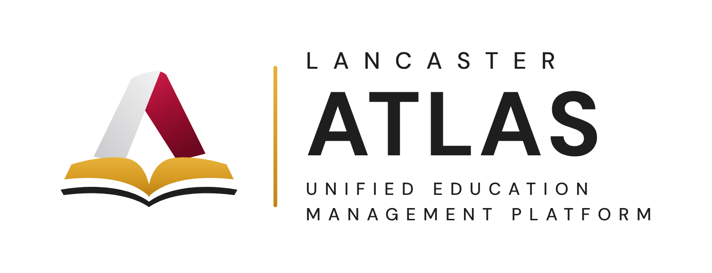

# Lancaster ATLAS



**Lancaster ATLAS** is the Unified Education Management Platform of Lancaster Technology and Development Corporation (LTDC), the school-side sibling of the Lancaster ERP, [CORE](../README.md).
It is built the same way as CORE: one Node.js program with **no dependencies**, a browser app with no build step, and all data in one file, `data/db.json`.
It runs on your own computer, or online on Amazon EC2 (see [Putting it online](#putting-it-online-aws)). The brand (mark, colours, product names) is described in [docs/BRAND.md](docs/BRAND.md). ATLAS Academic was planned against the CBSUA UIS: see [docs/ACADEMIC-PLAN.md](docs/ACADEMIC-PLAN.md) for the benchmark, what is built and what comes next. ATLAS Finance follows COA, DBM and BIR rules: see [docs/FINANCE-PLAN.md](docs/FINANCE-PLAN.md) for the research, how each requirement is met and what to confirm before going live.

ATLAS is a family of products behind one sign-in:

| Product | What it is | Status |
| --- | --- | --- |
| **ATLAS Learn** (LMS) | Classes, lessons, quizzes, attendance, grades and enrollment, with its admin panel | Live |
| **ATLAS People** (HRIS) | Employee records, time clock, leave, payroll and payslips; self-service for every employee | Live |
| **ATLAS Academic** (UIS) | Student records, curricula and evaluation, grade sheets, documents, CHED/FHE reports | Live (release 1) |
| **ATLAS Finance** (FMIS) | Government accounting: card file, accounts, budget, inventory, property, disbursement, revenue, control panel | Live (release 1) |
| **ATLAS Facilities** | Rooms and venues, bookings, maintenance, property | Coming soon |

Everyone starts at the **ATLAS home page**, the school's single front door to these systems:

| Address | What it is |
| --- | --- |
| <http://localhost:3100> | **ATLAS home**: one sign-in for students, parents, faculty and staff, then a tile for each system they may use, with school announcements and events |
| <http://localhost:3100/lms/> | **ATLAS Learn** for students, teachers and parents |
| <http://localhost:3100/admin> | **ATLAS Learn admin panel** for administrators and registrars (it also keeps its own sign-in page) |
| <http://localhost:3100/hris/> | **ATLAS People** for every employee (self-service) and for HR and payroll staff |
| <http://localhost:3100/academic/> | **ATLAS Academic** for the registrar's office and deans, teachers' grade sheets, and students' own records |
| <http://localhost:3100/finance/> | **ATLAS Finance** for the accounting, budget, cashier's and supply offices, and self-service for employees (property, cash advances, requests) and students (their receipts) |
| <http://localhost:3100/verify/CODE> | Anyone checks a document printed from Academic (the QR code on it opens this page) |

**ATLAS Learn**, **ATLAS People**, **ATLAS Academic** and **ATLAS Finance** are live. **Facilities** shows greyed out as *Coming soon* until an administrator switches it on under **Admin panel → Home page & systems** with the address it runs at. Students do not see the ATLAS People tile.

The web addresses (`/lms/`, `/hris/`), the `lms` folder, the server's service names (`ltdc-lms`) and the sign-in cookies keep their old names, so existing installs, bookmarks and servers keep working after the rename.

### Campuses

A school can have several campuses (e.g. Pili, Sipocot, Pasacao, Calabanga). Every campus has the **same features**, catalog (programs and courses), terms, modules, grading and branding; each has **its own** students, teachers, registrars, sections (with their enrollments and class content), news and events.

- **Switch campus** from your name at the top right (as in the current LMS). The choice is remembered; every list follows it: dashboard, students, teachers, sections, enrollment requests, news and events. The current campus shows in the top bar.
- **Administrators** reach every campus. **Registrars** and **teachers** work at the campuses ticked on their account (a teacher at two campuses switches to see each one's classes). **Students** belong to one campus, see only its sections and cannot request another campus's (the registrar can override for a cross-campus enrollee).
- **Admin panel → Campuses** adds, renames and removes campuses. News and events are for one campus, or (administrators only) for every campus.
- Data from before campuses moves into a "Main Campus" automatically; rename it under Campuses. The first-run setup asks for the campus name.

Signing in on the ATLAS home page opens the right side for the account (students, teachers and parents: ATLAS Learn; administrators and registrars: the admin panel; HR and staff accounts: ATLAS People), so opening a system from its tile needs no second sign-in. Every page has an **All systems** button back to the ATLAS home page, and **Sign out** anywhere signs out of everything.

## Run it

You need Node.js 18 or newer (the same one the ERP uses). If you don't have it, download the **LTS** installer from <https://nodejs.org> and run it (one time only).

### Without the terminal: double-click

Open the `lms` folder and double-click:

- **Windows:** `Start ATLAS (Windows).bat`. If Windows shows "Windows protected your PC", click **More info → Run anyway**.
- **Mac:** `Start ATLAS (Mac).command`. If macOS says it **could not verify** the file (it does this for files downloaded in a browser, e.g. GitHub's *Download ZIP*), allow it once:
  1. Click **Done** on the warning (not *Move to Trash*).
  2. Open **System Settings → Privacy & Security**, scroll down to **Security**, and click **Open Anyway** next to *"Start ATLAS (Mac).command" was blocked*. The button shows for about an hour after the blocked attempt.
  3. Enter your Mac password and click **Open Anyway**.

  After that it opens with a double-click. Getting the code with **GitHub Desktop** (cloning) instead of *Download ZIP* avoids the warning altogether.

A small window opens and your browser opens the ATLAS home page at <http://localhost:3100>. **Keep that window open** while you use ATLAS; close it to stop it.
Double-clicking again while it is running just opens the browser again.

### From the terminal

```bash
cd lms
npm start
```

Open **<http://localhost:3100>**. The first time, it points you to the admin panel to create the **Administrator** account and name the school.

The ERP runs on port 3000 and the LMS on port 3100, so both can run at the same time. Their sign-in cookies have different names, so signing in to one does not sign you out of the other.

To try it out, open **Demo data & backup → Add demo data** in the admin panel. Then sign in:

| Where | Username | Password | What to try |
| --- | --- | --- | --- |
| ATLAS home | `student.demo` | `demo1234` | Home To-do; take *Quiz 1* in IT201 A (timed, 2 attempts); resources with a PDF preview; attendance; news. Enrollment: one section is full (join its waitlist), one needs the key `DB2026`, one is blocked by a prerequisite |
| ATLAS home | `teacher.demo` | `demo1234` | IT201 A: quiz results and essays to score, work to grade, take attendance, gradebook, build a new quiz |
| ATLAS home or admin panel | `registrar.demo` | `demo1234` | Approve requests, admit 2 applicants, manage the waitlist |
| ATLAS home → People | `hr.demo` | `demo1234` | HR dashboard; approve the pending leave (one sick leave has a medical certificate attached); employee records and sign-in accounts; attendance; switch to Sipocot campus |
| ATLAS home → People | `payroll.demo` | `demo1234` | Government payroll: two finalized runs (General Payroll, remittances, payslips with loans), this year's mid-year bonus and the year-end bonus and cash gift as a draft; an employee's loans on their record; payroll setup with the salary schedule |
| ATLAS home → Learn | `parent.demo` | `demo1234` | A mother (Lorna Reyes) following Carlo Reyes (everything shared) and her nephew Kevin Navarro (grades, attendance and activities only). `father.demo` is Carlo's father, without activities |
| ATLAS home → People | `staff.demo` | `demo1234` | A librarian's self-service: clock in, file leave, payslips. `teacher.demo` has the same in the HRIS tile |
| ATLAS home → Academic | `registrar.demo` | `demo1234` | The dashboard's work queue; Carlo Reyes's record (evaluation against BSIT 2026, back subjects, grades, profile, history); post the approved ED101 grade sheet; print a TOR and check its QR code; document requests from unpaid to released; CHED list, FHE billing CSV and the enrollment summary |
| ATLAS home → Academic | `dean.demo` | `demo1234` | A dean (Elena Cruz): approve last term's GE101 grade sheet, approve the waiting INC completion, finish the draft BSED 2027 curriculum and post it |
| ATLAS home → Finance | `accountant.demo` | `demo1234` | The Chief Accountant (Teresita Lopez): certify the waiting voucher (Box C), post the draft accrual, trial balance and financial statements per fund, ledgers, bank reconciliation, close a month, the Control panel |
| ATLAS home → Finance | `budget.demo` | `demo1234` | The Budget Officer: obligate the library's ORS (Box B), allotment balances, the SAAODB, RAOD and aging reports |
| ATLAS home → Finance | `cashier.demo` | `demo1234` | The Cashier (bonded): pay the approved voucher, issue an O.R. to a student, prepare the RCD and record the deposit, the taxes withheld, BIR 2307s and remittances, LDDAP-ADA, cash advances (one overdue) |
| ATLAS home → Finance | `supply.demo` | `demo1234` | The Supply Officer: issue the waiting requisition, purchase orders and their deliveries (one late, with liquidated damages), stock cards, RSMI, property with PAR/ICS, depreciation |
| ATLAS home → Finance | `head.demo` | `demo1234` | The approving officer (the University President): approve the purchase request and the voucher waiting for Box D |
| ATLAS home → Academic | `student.demo` | `demo1234` | Carlo's own evaluation (what he can take next), grades, his Certificate of Registration with a QR code, and requesting a document. `teacher.demo` submits grade sheets there |

The demo school has about 260 accounts: 5 programs (IT, Computer Science, Business, Agriculture, Education), 18 teachers, about 190 students with past grades (130 at the main campus), 11 applicants, about 40 parents and guardians (each sharing something different; one is paused), and HR, payroll and staff sign-ins. There are 21 courses and about 40 sections this term at the main campus. Every class has lessons, announcements, a course outline (PDF), graded work, a quiz most students have taken and a few weeks of attendance; there are also school news posts with reactions and comments, and upcoming events. Other teacher accounts: `lmercado.demo`, `gaquino.demo`, `rvillareal.demo` (Agriculture), `lgonzales.demo` (Business), `mtorres.demo` (Education), `jdelacruz.demo`, `aramos.demo`, `psison.demo` (Computing), `rmanalastas.demo` (General Education), `jcabrera.demo` (Business), `vbayani.demo` (Agriculture and Education). Parent accounts are named after their student, e.g. `p.camille.navarro`; the full list is under *Admin panel → Parents & guardians*. Every demo account uses the password `demo1234`. It's the same school every time it is added. The demo school is at your first campus, and three smaller demo campuses (Sipocot, Pasacao, Calabanga) are added beside it, each with its own teachers, students and classes. `teacher.demo` also teaches a Friday class at Sipocot, and `registrar.demo` works at both, so both can try switching campus. In Academic, the demo adds 4 colleges, posted 2026 curricula for BSIT, BSCS, BSBA and BSA and a draft for BSED, a profile and requirements for every student (a few missing), last term's grade sheets (four posted, one approved and waiting to be posted, one waiting for the dean), an INC with its completion waiting for approval, a transferee's credited subject, document requests in every status, and the dean account `dean.demo`. In Finance, the demo keeps the books for this fiscal year so far: beginning balances, the GAA and board-approved budgets with their allotments and NCAs, three purchases (one paid by check, one delivered late and paid by LDDAP-ADA, one partly delivered), monthly electricity and janitorial payments with their taxes remitted, a legal retainer, two cash advances (one liquidated with a refund, one overdue), CHED's FHE billing and students' fees with their RCDs and deposits, stock issues and RSMIs, the school's property with its PAR/ICS and depreciation, a disposal, and something waiting in each office's queue. `teacher.demo` (Maria Santos) has property in her custody and can request supplies; `student.demo` sees his receipts.
For the HRIS, every demo teacher and the registrar have an employee record linked to their account, with non-teaching staff beside them (guidance, nurse, ICT, guards, utility), six weeks of attendance, leave requests in every state and two finalized payroll runs.

Demo records are added **next to your own data** and **Remove demo data** takes them out again without changing your records. If you already have a current term, it stays current and the demo term is listed beside it.

Other settings: `PORT=3101 npm start` (another port), `HOST=0.0.0.0 npm start` (let other computers on your network open it), `DB_FILE=/path/db.json` (another data file).

## Help & guides

Every system has a **Help** button (the question mark in the top bar). It opens **Help & guides** (`/help/`) at the guide for that person's job there: students, parents, teachers, registrars, deans, administrators, HR, payroll, employees (self-service) and each Finance office. Each guide has a walkthrough with screenshots of the demo school, how-to steps for each task, a table of every screen, and common questions; there is also *Getting started* and *What's new*. Guides can be searched and printed.

- **They come with ATLAS.** The guides are written in `docs/guides/` next to the code (format and process: [docs/guides/README.md](docs/guides/README.md)), so every update brings its guides. A test fails when a screen in any sidebar has no guide, or a screenshot is missing; `npm run guides:screenshots` retakes the screenshots from the demo school (needs Playwright).
- **Administrators can edit them** (**Edit this guide**, with a live preview) and add the school's own guides. The school's version is kept across updates; when an update changes a guide the school has edited, the administrator is told and can compare, copy in what is new, or restore the built-in guide.

## Admin panel

| Page | What it does |
| --- | --- |
| **Dashboard** | Current term and its enrollment window, pending requests, waitlists, applicants, fullest sections, recent activity |
| **Enrollment requests** | Approve or reject pending requests; *Enroll over capacity* or reject waitlisted ones; drop enrolled students; add a student to a section; every step's history |
| **Applicants** | People who applied from the portal. *Admit* gives them a student number (e.g. `2026-0001`) and lets them sign in; *Decline* keeps a reason on record |
| **Students / Teachers** | Accounts, with each student's full enrollment record and grades and each teacher's sections |
| **Sections** | A course offered in a term: teacher, days and times, room, capacity, enrollment key, status (open, closed, cancelled). Shows enrolled, pending, waitlist (in order) and past students |
| **Courses** | The catalog: code, title, units, description, prerequisites, programs |
| **Terms** | Class dates, the enrollment window, the drop deadline, and which term is current |
| **Programs** | e.g. BS Information Technology |
| **News & events** | School-wide posts (pin, turn comments off, remove comments) and events, shown on everyone's home page |
| **Modules** | Turn each portal module on or off, separately for **students** and **teachers** |
| **Activity types & grading** | Types teachers pick for each activity (Assignment, Short Quiz, Long Quiz, Examination… add your own) and how much each counts in the running grade |
| **Settings & branding** | School name, passing grade, enrollment rules, student applications; the school's **colour** (presets or its own) and **logo**, and the sign-in headline |
| **Admins & registrars** | Admin-panel accounts |
| **Demo data & backup** | Add or remove demo data; download or restore a backup. The backup file holds the records; uploaded files are in `data/files/`, so to keep everything, copy the whole `data` folder |

### Modules for students, teachers and parents & guardians

| Module | Students | Teachers | Parents & guardians |
| --- | --- | --- | --- |
| Enrollment | Browse sections, enroll, join waitlists, drop | Class list and waitlist | Their student's requests, enrolled classes and units |
| Class schedule | Weekly timetable | Teaching timetable | Their student's timetable |
| Lessons & materials | Read lessons, open materials | Write lessons, publish or hide them | Not offered |
| Announcements | Read | Post | Not offered |
| Resources | Open and download files and links, with a preview (PDF, images, video, YouTube) | Upload files (up to 10 MB each, drag and drop) and add links; hide or show them | Not offered |
| Activities & quizzes | Hand in work (text, a file, a link); take quizzes and exams with a timer; see scores, feedback and (when released) the answers | Create assignments, quizzes and exams; grade one student after another; score essays; results per question | What is due, handed in, missing or past due, and scores (never the questions or answers) |
| Attendance | Their attendance and rate per class | Take attendance (present, late, absent, excused), monthly grid, CSV export | Rate per class and each late, absent or excused day |
| Grades | Running grade, scores and final grades | Gradebook (weighted by activity type), CSV export, post final grades | Running grade per class, final grades, past terms |
| News & events | Read school news, react and comment; upcoming events | The same | The same |

A module that is off disappears from that account type's menu, **and the server refuses it** (it is not only hidden). Turning a module off never deletes anything.
For example, switch *Enrollment* off for students outside enrollment season so only the registrar can add or drop classes.

### Account types

| Account type | Signs in on | Can do |
| --- | --- | --- |
| **Administrator** | Admin panel | Everything, including modules, settings, admin accounts, demo data and backups |
| **Registrar** | Admin panel | Enrollment requests, applicants, students, the catalog (courses, sections, terms, programs); can view teachers. In Academic: student records, curricula, posting grade sheets, documents, reports and settings |
| **Dean / Program chair** | Admin panel | In Academic: curricula, colleges, student records (view), approving grade sheets and grade changes |
| **Teacher** | Portal | The sections assigned to them, as far as the modules allow |
| **Student** | Portal | Enrollment and their classes, as far as the modules allow; sees which parents and guardians are linked to them |
| **Parent / Guardian** | Portal | Follows the students linked to them, read-only, as far as each link and the modules allow (see [Parents & guardians](#parents--guardians)) |

Passwords and sign-in work as in the ERP: temporary passwords must be changed at first sign-in, 5 wrong passwords lock the username for 5 minutes, and people are signed out after 8 idle hours or when the app restarts.
Locked-out administrator? Stop the app and run `npm run reset-password -- <username> <new-password>`.

## Parents & guardians

Parents and guardians get their own account type and their own section of the LMS. They sign in on the ATLAS home page and open ATLAS Learn, where they see **only the students linked to them** and **only what each link shares**. They can look; they cannot change anything.

- **Your students** (their home): a card per student with this term at a glance (running grade, attendance rate, enrolled units, activities due) and what is worth a look: a pending enrollment request, absences, a class below the passing grade, work not handed in after the due date.
- **A student's page**, with a tab for each shared view and a term picker: **Enrollment** (requests and their status, waitlist position, units), **Class schedule** (the week's timetable), **Grades** (running grade per class, final grades, past terms), **Attendance** (rate per class and each late, absent or excused day), **Activities & quizzes** (due, handed in, late, missing, scores; never the questions or answers).
- **News & events**, like students and teachers. Nothing else in the LMS is open to them; the server refuses it.

**Who decides what they see.** Registrars and administrators (*Admin panel → Parents & guardians*, or the student's record) make guardian accounts and link them to students. Each link has a relationship (Mother, Father, Guardian, Grandparent…) and its own views, ticked one by one: a student's grades and attendance can be shared without their enrollment, for example. A link can be paused or removed. On top of that, *Modules* has a **Parents & guardians** column: a view switched off there is off for every guardian. One guardian can follow several students (siblings), and a student can have several guardians.

**Students know.** A student's *Parents & guardians* page lists everyone linked to their records, what each can see, and when they last looked. Guardians belong to the campuses of their students, so registrars manage the ones at their own campuses.

## Academic (student information system)

**ATLAS Academic** (<http://localhost:3100/academic/>) is the registrar's system, built on Learn's catalog (programs, courses with prerequisites, terms, sections, enrollments). Release 1:

- **One student record** with tabs: overview (this term's subjects, requirements checklist), **evaluation** against the student's curriculum (passed, credited, taking now, can take, back subjects, units earned, GWA), **grades** (the permanent record by term), documents, profile (personal details, LRN, educational background, program, curriculum, year level, student type) and history (every change, who and when).
- **Curricula** (the prospectus): built year by year and term by term from the catalog, with prerequisite-order warnings and laboratory units; posting locks a curriculum; a new series starts as a copy. **Colleges** group programs.
- **Grade sheets**: the teacher submits a class's final grades from Learn's gradebook (marking INC where needed); the dean approves or returns it with a reason; the registrar posts it to the permanent record. Grades become equivalents on the grading scale (99–100 = 1.00 … 75 = 3.00, below 75 = 5.00; editable).
- **Grade changes** (rectifications and INC completions) need a reason and **a second person's approval**; the old grade stays in the record's history.
- **Credited subjects** for transferees, with the school and the original code.
- **Documents**: Transcript of Records, Certificate of Grades, of Enrollment, of Registration (students print their own COR), good moral, honorable dismissal. Each printout has a code and a **QR code**; anyone can check it at `/verify/<code>`. Students request documents online and follow them from requested → paid (O.R. number) → processing → ready → released.
- **Reports**: CHED enrollment list, FHE billing details (UniFAST Form 2, with lecture and laboratory units), enrollment summary by program, year and sex, failing grades and INCs, dean's list, candidates for graduation. All print on A4 and export to CSV.
- **Settings**: grading scale, admission requirements by student type, document fees, the registrar's signature line, INC deadline, dean's-list rules.

Who uses it: administrators and registrars (everything), deans (curricula, approving grade sheets and grade changes), teachers (their grade sheets), students (their own record). Parents and HR accounts do not see Academic. Admissions with entrance exams, block sections and schedule codes, fee assessment and cashiering, and scholarships are the next phases (see the plan).

## Finance (government accounting)

**ATLAS Finance** (<http://localhost:3100/finance/>) is the accounting system of a state university or college, per the COA Government Accounting Manual and Revised Chart of Accounts, DBM budget execution and BIR withholding (details and sources: [docs/FINANCE-PLAN.md](docs/FINANCE-PLAN.md)). Release 1 has the eight modules of the bid:

- **Card File**: suppliers, employees, accountable officers (with their fidelity bond), agencies and individuals, each a subsidiary ledger with its documents and taxes withheld.
- **Accounts**: the Revised Chart of Accounts; journal entry vouchers in four journals (posted, never edited, reversed when wrong); general and subsidiary ledgers; trial balance; Statements of Financial Position and Performance per fund cluster; bank reconciliation; closing a month; year-end closing.
- **Budget**: appropriations, allotments (GARO/SARO/board approvals), NCAs; obligation requests (ORS for fund 01, BURS for the others) with Box B checking the allotment; SAAODB (FAR 1), RAOD, aging of obligations (FAR 3), SCBAA.
- **Inventory**: purchase requests, purchase orders under RA 12009 (with their obligation), inspection and acceptance (stock, property and the payable; liquidated damages for late delivery), stock cards with FIFO cost, requisitions (RIS), RSMI and the physical count.
- **Property**: PPE and semi-expendable property, PAR and ICS, transfers, returns, disposal (IIRUP), monthly straight-line depreciation, RPCPPE.
- **Disbursement**: disbursement vouchers through Boxes A–E (Box D never by the preparer or certifier), checks and LDDAP-ADA, cash advances and liquidation, BIR withholding (1% / 2% EWT, 5% creditable VAT, 3% percentage tax…), the monthly summary, remittances by TRA, the quarterly alphalist and BIR Form 2307.
- **Revenue**: official receipt booklets for each collector, official receipts (students see theirs), the Report of Collections and Deposits and the deposit, the RAAF, revenue against targets.
- **Control panel**: entity and fiscal year, fund clusters, offices, PAPs, bank accounts, fees, signatories, document numbering, tax rates, thresholds, periods, Finance accounts and roles, the audit trail.

Every form prints on A4 after its GAM appendix. Finance accounts (Chief Accountant, Budget Officer, Cashier, Supply & Property Officer, Approving Officer) are created by an administrator in the Control panel (or in People) and sign in on the ATLAS home page; every other employee gets Finance self-service with their own account once the accounting office links it to a card.

## Single sign-on (Keycloak)

ATLAS can let people sign in with the school's **Keycloak** account (OpenID Connect; any standard OIDC provider works the same way). A **Sign in with Keycloak** button then appears on the ATLAS home page and the admin panel's sign-in page.

- **Who can sign in:** only people who already have an ATLAS account. Keycloak proves who they are; ATLAS still decides what they may do. The first sign-in matches the Keycloak user to an ATLAS account by **email** (it must be verified in Keycloak) or by **username**, then links the two; later sign-ins use the link, even if the email changes.
- **Passwords:** can stay on beside Keycloak, or be switched off. Off, everyone except administrators must use Keycloak; administrators keep their password so there is a way in if Keycloak is down.
- **Signing out** of ATLAS also ends the Keycloak session.
- **Security:** authorization code flow with PKCE, a state bound to the browser, a nonce, and the ID token's signature checked against Keycloak's published keys (RS256, PS256 or ES256), with its issuer, audience and expiry. No new dependencies.

To set it up:

1. In Keycloak, in the school's realm: **Clients → Create client** (OpenID Connect), Client ID e.g. `atlas`; **Client authentication** on, **Standard flow** on. Add the **Valid redirect URI** and **Valid post logout redirect URI** that *Admin panel → Single sign-on* shows (they look like `https://your-domain/api/sso/callback` and `https://your-domain/`), and Web origins `+`.
2. Put the client's secret on the server as `OIDC_CLIENT_SECRET` (on EC2: in `/etc/ltdc-lms/app.env`, see the EC2 guide) and restart ATLAS. The secret is never stored in the data file, backups or the admin panel.
3. In **Admin panel → Single sign-on**: the issuer (`https://sso.school.edu/realms/<realm>`), the client ID, the button text and how to match accounts; **Test connection**; then switch it on. ATLAS refuses to switch on if Keycloak does not answer.

If ATLAS shows the wrong address for the redirect URIs (e.g. behind an unusual proxy), set `PUBLIC_URL=https://your-domain` on the server.

## HRIS

The Human Resource Information System, built from the [Lancaster ERP's HR & Payroll](../README.md) module: the same time, leave, pay, contribution and tax rules (`shared/calc.js` and `shared/leave.js` are the ERP's files; a test checks the two stay identical), reworked for a school with campuses.

**Everyone with an employee record** (teachers, registrars, staff) gets **self-service** in the HRIS with the sign-in they already have:

- **My day**: a time clock (clock in and out, with the phone's or laptop's location recorded at clock-in), today's status and this pay period's hours, late, undertime and overtime.
- **My attendance**: the daily time record (DTR).
- **Leave & requests**: balances per leave type; file leave or remote work (with a medical certificate for sick leave of more than 3 days); withdraw a pending request.
- **My payslips**: finalized payslips, printable or saved as PDF. **My profile**.

**HR screens**, for HR managers, payroll officers and administrators, always for the campus they are looking at:

| Screen | What it does |
| --- | --- |
| HR dashboard | Headcount (teaching and non-teaching), today's attendance per employee (working, done, on leave, remote, not in, minutes late), requests to review, leave in the next two weeks, departments, employment status, birthdays, the latest payroll |
| Employees | Records (personal, employment, pay, schedule, government IDs, bank), CSV export, and the **sign-in account**: link a teacher's or registrar's LMS account, or create an HRIS account (Staff, HR Manager, Payroll Officer); reset its password or disable it |
| Attendance (DTR) | Every record with late, undertime and overtime; add or correct records; approve overtime; CSV export. HR managers and administrators also see where each clock-in was made |
| Time clock | One shared computer at the campus (HR office, faculty room): employees pick their name and clock in or out |
| Clock-in locations | Where each clock-in at the campus was made, on a map, flagged *Away from campus* when outside the campus radius (never blocked); the campus location, radius and how long locations are kept (365 days by default); CSV export. HR managers and administrators only |
| Leave & approvals | Approve, reject or cancel requests (approval writes the days into the DTR; HR cannot approve their own); leave balances per person; one employee's leave (credits, access to a leave type, adjustments with a reason, leave recorded on paper); leave types (gender rules, medical certificate rules) |
| Payroll | A run per pay period and campus (semi-monthly or monthly): the payroll register, adjustments, recompute, finalize, payslips, register export. **Government payroll** (the default): salary grade and step, PERA, RATA, GSIS, PhilHealth, Pag-IBIG, BIR withholding tax and loans; bonus runs (mid-year bonus, year-end bonus and cash gift, PEI, clothing allowance); the **General Payroll** (COA GAM Appendix 33) and a **remittance summary** per agency (GSIS, PhilHealth, Pag-IBIG, BIR, loans) with CSV files. Private-school payroll (SSS) is the ERP's |
| Payroll setup | Government or private payroll; GSIS, PERA, minimum net pay, tardiness and overtime rules, bonus amounts; the EO 64 salary schedule; contribution rates and tax tables, with a calculator to try them |
| HR settings | The employer's address and TIN on payslips, the default work schedule, and who can do what |

### HRIS account types

| Account type | Signs in on | Can do in the HRIS |
| --- | --- | --- |
| **HR Manager** | ATLAS home | Employees and their accounts, attendance, clock-in locations and the time clock, leave approvals and credits, view payroll, payroll setup, HR settings |
| **Payroll Officer** | ATLAS home | Payroll runs and payroll setup; views employees, attendance and leave |
| **Staff** | ATLAS home | Self-service only (a non-teaching employee) |
| Administrator | (any) | Everything, at every campus |
| Teacher, Registrar | (their own) | Self-service, once HR links their account to their employee record |

### Government payroll

For a state university or college, payroll follows the national government's rules (`shared/gov-pay.js` lists each rule and its source):

- **Salary** from the employee's **salary grade and step** under EO 64, s. 2024: the 2026 (third tranche) and 2027 (fourth tranche) schedules are built in, and each payroll uses the schedule in force at the end of its period, so January payroll moves to the new tranche by itself. Employees without a plantilla position (job order, contract of service) are paid a daily rate for days worked, with no GSIS, PERA or bonuses and tax withheld at the rates in Payroll setup.
- **Absences without pay** at the daily rate (monthly ÷ 22); **tardiness and undertime** charged to vacation leave credits first (CSC), the rest from pay. Finalizing the run takes the leave off the credits; deleting the run gives it back.
- **PERA** (₱2,000 a month, less 1/22 per day without pay) and **RATA** (the official's monthly rate, by days of actual work in the month: 17+ days 100%, 12–16 75%, 6–11 50%, 1–5 25%), both not taxable.
- **GSIS** 9% personal and 12% government share, **Employees' Compensation** ₱100; PhilHealth and Pag-IBIG as for everyone; BIR withholding tax on pay less the contributions.
- **Loans and other deductions** on the employee's record (GSIS, Pag-IBIG, provident fund, cooperative, dues…), taken in order (GSIS first) with the balance kept from finalized runs; one that would bring net pay below ₱5,000 a month (GAA) is held back and listed.
- **Bonus runs**: mid-year bonus (one month's salary, 4 months of service by 15 May), year-end bonus and ₱5,000 cash gift (4 months by 31 October; less than that, a prorated cash gift), PEI and clothing allowance. Bonuses are tax-free up to ₱90,000 a year in all; tax is withheld only on the excess. A person can be left out of a run with a reason (e.g. a rating below Satisfactory).
- Overtime is earned as **compensatory time-off** (COC) by default; Payroll setup can make it paid instead (125% / 150%, at most 50% of the monthly salary).
- **To Finance** (the run's *Finance* tab, payroll officer): a finalized run prepares its **ORS/BURS** (one line per object code: salaries, PERA, RATA, bonuses and the government shares, charged to the PS allotment; job orders to MOOE). Once the budget office obligates it, the **payroll voucher**: gross = the obligation, withholdings and government shares to Due to BIR, GSIS, Pag-IBIG, PhilHealth and Other Payables, net = the General Payroll's net pay; Finance certifies, approves and pays it by LDDAP-ADA, which posts the journal entry. Once paid, **remittance vouchers** to GSIS, PhilHealth, Pag-IBIG and BIR. All through Finance's own rules; a run with live Finance documents cannot be deleted.
- An employee who moved campus is not paid twice for a period or a bonus; someone who left after a bonus's cut-off date (record their **date separated**) still gets it.
- A school that already ran private (SSS) payroll before this update stays on private payroll until Payroll setup is switched.

**Clock-in locations** come from the browser's location when someone clocks in (on My day or the time clock). The browser asks for permission once; without it, or on a plain `http://` address, the clock-in is recorded without a location. Locations are only ever sent to HR managers and administrators, never to the employee or payroll. Set each campus's point under **Clock-in locations → Set campus location** (standing on campus and pressing *Use this device's current location* is the quickest way).

The first HR manager is made by an administrator: open the HRIS from the portal, add the HR manager's employee record, then **Sign-in account → Create an HRIS account** with the type *HR Manager*. HR accounts work at the campus of their record; an administrator can add campuses to them in the LMS admin panel. Students have no HRIS.

## How enrollment works

A student picks a section under **Enrollment → Open sections**. The request is checked in this order:

1. The section is open, and the term's **enrollment window** is open today.
2. The **enrollment key** matches, if the section has one.
3. The student is not already enrolled, pending or waitlisted in **the same course** this term.
4. The student has not **already passed** the course.
5. Every **prerequisite** has been passed (a final grade at or above the passing grade, 75 by default).
6. The **unit limit** for the term is not exceeded (24 by default; enrolled + pending + waitlisted).
7. There is **no schedule conflict** with the student's other classes (back-to-back classes are fine).
8. A seat is free → **Pending approval** (or **Enrolled** straight away when approval is switched off).
   No seat → **Waitlisted**, if waitlists are on and the waitlist is not full; otherwise refused.

The catalog shows, for every section, whether the student can take it and **why not** (e.g. "IT202 requires IT201 first").

- **Waitlist:** when a seat frees up (a drop, a rejection, a cancelled request, or the registrar raising the capacity), the first student in line moves up automatically.
- **Dropping:** students can withdraw pending or waitlisted requests at any time, and drop enrolled classes until the term's drop deadline. After that, the registrar drops them.
- **Registrar:** adds students regardless of the window and key; with *Override the rules* also past prerequisites, the unit limit, conflicts and a full section. Can enroll a waitlisted student over capacity.
- **Cancelling a section** drops everyone in it. A teacher cannot be given two sections that meet at the same time.
- **Completing:** when a teacher posts a final grade, the enrollment becomes *Completed* (passed or failed), which is what prerequisites look at.
- Every enrollment keeps its **history**: each status, who changed it, when, and the note.

**Student applications** (Settings → Student applications): when on, the portal's sign-in page shows *Apply as a student*. Applicants choose a username and password, appear under **Applicants**, and can sign in once admitted.

## Quizzes and exams

- **Question types:** one answer, several answers (partial credit: each right pick adds, each wrong pick takes away), true or false, short answer (several accepted answers; capitals and spaces ignored) and essay (scored by the teacher).
- **Settings per quiz:** opening and closing time, time limit, number of attempts (the highest score counts), shuffled question order, and when students see the correct answers (right after submitting, after the quiz closes, or never).
- **Fair timing:** the server sets each attempt's deadline when it starts (the time limit, or the closing time if sooner) and refuses answers after it. Answers save as the student goes; when time runs out the quiz submits itself, even if the student closed the page. Students never receive the answer key before results are released.
- **Results:** average, highest and lowest; each student's best attempt; how each question went (questions most of the class missed are shown in red); essays waiting to be scored.

## Grading

Each activity has a type with a weight (Settings: **Activity types & grading**). The running grade combines each type's percentage by its weight, leaving out types with no scored work yet. Example with assignments 30%, quizzes 20%, exams 50%: a student with 80% on assignments and 90% on quizzes and no exam yet has (80×30 + 90×20) ÷ 50 = 84%. Set every weight to 0 to count every point the same. Teachers post final grades (they can fill them from the running grade); a final grade at or above the passing grade completes the class and counts for prerequisites.

## Look and feel

The layout follows the school's current LMS (top bar with the seal and the current term, a sidebar with icons, breadcrumbs, a class header with the teacher, tabs for each part of a class) with one brand colour throughout, chosen under **Settings & branding**, and the school's own logo. Everyone can switch to **dark mode** (moon button; remembered per browser), and the sidebar folds to icons. On phones the sidebar becomes a drawer and tables become cards. A comparison with the current LMS and other open-source LMSes is in [docs/BENCHMARK.md](docs/BENCHMARK.md).

## For developers

```
lms/
  server.js              HTTP server: the portal (/), the LMS (/lms/), the admin panel (/admin), /api, /healthz
  server/api.js          router, the two sign-ins, applications, demo data and backups
  server/enrollment.js   the enrollment rules (evaluate, enroll, waitlist, drop) and their routes
  server/admin.js        admin panel: accounts, applicants, catalog, sections, modules, settings, dashboard
  server/classroom.js    portal: classes, lessons, announcements, activities, grades, schedule, home
  server/quiz.js         quiz questions, attempts, deadlines, automatic grading, results
  server/attendance.js   attendance per class and date
  server/files.js        uploaded files (data/files/) and class resources
  server/news.js         school news (reactions, comments) and events
  server/db.js           JSON-file storage (and an in-memory one for tests)
  server/campus.js       campuses: who can reach which campus, the active campus
  server/demo.js         demo data
  server/hris.js         HRIS: employees and their accounts, DTR and time clock, payroll, dashboard, self-service
  server/hris-leave.js   HRIS: leave types, credits, balances, requests and approval (from the ERP)
  server/hris-demo.js    HRIS demo data
  server/guardian.js     parents & guardians: links, what each can see, their pages and the registrar's
  shared/guardians.js    the views a link can share, and relationships
  server/academic.js     ATLAS Academic: curricula, records, evaluation, grade sheets, grade changes, documents, reports
  server/academic-demo.js  Academic demo data
  shared/academic.js     grading scale, document types, requirements, GWA (server and browser)
  public/academic/, public/js/academic/  the Academic app; public/verify.html  the document check page
  public/js/vendor/qrcode.js  QR codes (qrcode-generator, MIT, vendored)
  server/finance.js      ATLAS Finance core: Control panel, card file, chart, journal entries, ledgers, statements, bank reconciliation, closing
  server/finance-budget.js  appropriations, allotments, NCAs, ORS/BURS, SAAODB, RAOD, aging, SCBAA
  server/finance-supply.js  purchase requests and orders, IAR, stock (FIFO), RIS, RSMI, physical count, property, depreciation
  server/finance-cash.js    disbursement vouchers, LDDAP-ADA, cash advances, taxes and 2307, official receipts, RCD, revenue
  server/finance-demo.js    Finance demo data (made through Finance's own routes)
  shared/finance.js      chart of accounts, fund clusters, withholding taxes, depreciation, numbering, amount in words
  public/finance/, public/js/finance/, public/css/finance.css  the Finance app and its printable forms
  docs/FINANCE-PLAN.md   ATLAS Finance: research, compliance and what to confirm before going live
  server/sso.js          single sign-on with Keycloak (OpenID Connect, PKCE, ID token checks)
  test/oidc-provider.js  a stand-in Keycloak for the tests (and demos: it has a sign-in page)
  shared/calc.js         time and payroll rules (the ERP's file): DTR, payslips, SSS, PhilHealth, Pag-IBIG, tax
  shared/leave.js        leave rules (the ERP's file)
  shared/roles.js        account types and permissions (server and browser)
  shared/modules.js      the switchable portal modules (server and browser)
  shared/schedule.js     meeting times and clash checks (server and browser)
  shared/themes.js       brand colour presets
  shared/brand.js        the ATLAS name, tagline and palette
  shared/systems.js      the ATLAS products on the home page (Learn, People, Academic, Finance, Facilities) and who sees each
  public/                ATLAS home (index.html, js/hub), ATLAS Learn (lms/index.html, js/portal), admin panel (admin/index.html, js/admin), ATLAS People (hris/index.html, js/hris, css/hris.css)
  public/js/shell.js     branding, dark mode, sign-in screens, top bar, sidebar, router (all the apps)
  public/js/icons.js     the icon set
  public/img/brand/      the ATLAS mark (light, dark, white, black) and app icon, as SVG
  scripts/brand-mark.py  draws the ATLAS mark SVGs (python3 scripts/brand-mark.py public/img/brand)
  docs/BRAND.md          brand guide; docs/brand/ has PNG lockups
  docs/ACADEMIC-PLAN.md  plan for ATLAS Academic (SIS), benchmarked against the CBSUA UIS
  test/                  node:test suites
```

- Run the tests with `npm test` (from `lms/`, or from the repository root, which runs the ERP's and the LMS's tests together).
- Every route states who may call it (`'student'`, `'teacher'`, `'guardian'`, `'portal'`, `'admin:<permission>'`, `'hris:<permission>'`) and, for portal routes, which module it belongs to. The router in `server/api.js` enforces both.
- Three session cookies: the portal's (students, teachers, parents), the admin panel's (administrators, registrars) and ATLAS People's (HR and staff accounts). ATLAS People routes accept whichever of them the browser has; signing in on the University Portal ends the others, so a browser is one person at a time.
- `public/css/styles.css` is built on colour tokens: `--brand` and `--accent` come from the branding settings and every shade is mixed from them, with a dark set under `[data-theme=dark]`.

### Ideas this borrows from

- **Moodle**: the self-enrolment key on a section, enrollment windows and a maximum number of students ([Moodle docs: Self enrolment](https://docs.moodle.org/401/en/Self_enrolment)).
- **Frappe Learning** (`frappe/lms`): courses → lessons, batches (here: sections), assignments graded by instructors.
- **Gibbon**: modules granted per role, here switched on or off for students and teachers.
- **openSIS / Fedena**: the student-information side: admissions applications, programs, terms, student numbers.

### Not included (yet)

In the HRIS: a shared clock-in kiosk, clock-in location (both in the ERP), holidays and holiday pay, 13th-month pay, loans, and DepEd/CHED leave rules for teachers (proportional vacation pay). Elsewhere: parents signing up on their own (an invitation code from the student), messages/chat, single sign-on (Keycloak/OIDC), question banks, copying lessons and activities between sections, certificates, a term-end "close term" step, email notifications and an audit log. See the roadmap in [docs/BENCHMARK.md](docs/BENCHMARK.md).

## Putting it online (AWS)

Follow **[deploy/aws/EC2.md](deploy/aws/EC2.md)**: one CloudFormation template (`deploy/aws/lms-ec2.yaml`) builds an EC2 server in a few clicks, with HTTPS at a DuckDNS address, a fixed IP, nightly backups, daily disk snapshots, security updates and automatic updates from this branch (installed only if the tests pass on the server, rolled back if they don't start). A **setup code** chosen in the template protects the first administrator account.

The app reads these settings (all set by the template): `COOKIE_SECURE=1`, `ALLOWED_HOSTS` (the site's address), `HOST`, `PORT`, `DB_FILE`, `SETUP_CODE`. `GET /healthz` answers `{ "ok": true }`.

**Security in the app** (see [docs/security/VAPT-2026-11.md](docs/security/VAPT-2026-11.md)):

- **Rate limits** (`server/ratelimit.js`): requests per signed-in person per minute (Settings → Sign-in and passwords, normally 300), four times as many per network address when signed out, and tighter limits on sign-in, password changes, applications, first-time setup, document checks, calendar feeds and Keycloak sign-ins. Over a limit, the API answers `429` with `Retry-After`. Counts are kept in memory, per server process. `RATE_LIMITS=off` switches them off (load tests only).
- **The visitor's address** is the last entry of `X-Forwarded-For`, believed only when the connection comes from this computer (Caddy). Keep `HOST=127.0.0.1` behind a proxy; on a LAN without a proxy the connection's own address is used.
- **Headers**: a Content-Security-Policy (no inline scripts except the dark-mode snippets, allowed by hash), `X-Frame-Options: SAMEORIGIN`, `nosniff`, `Referrer-Policy`, `Permissions-Policy`, `Cross-Origin-Opener-Policy` and `Cross-Origin-Resource-Policy`. Caddy adds HSTS.
- **Requests**: JSON bodies only, at most 20 MB; a malformed address or Host is answered `400`/`403`; request headers must arrive within 20 seconds.
- **Passwords** are stored only as scrypt hashes, and each hash is encrypted with AES-256-GCM under a key kept outside the data: `PASSWORD_KEY` (64 hex characters), else `password.key` beside the data file, made on first start (readable by the app only, not in backups). `PASSWORD_KEY_OLD` (comma-separated) reads hashes under earlier keys; they are re-encrypted under the current key two minutes after the start (`PASSWORD_SEAL_DELAY_MS`) and at each sign-in. Moving ATLAS to another computer: copy the whole `data` folder, key included. See [deploy/aws/EC2.md](deploy/aws/EC2.md), *The password key*.

When one server is no longer enough:

| Today | On AWS |
| --- | --- |
| `data/db.json` | Amazon RDS (PostgreSQL): one table per collection in `server/db.js`; every record already has an `id` |
| Sessions in memory | ElastiCache (Redis) or DynamoDB, behind `createSessions()` in `server/auth.js` |
| Uploaded files in `data/files/` | Amazon S3, behind `createFileStore()` in `server/files.js` |
| One EC2 instance | Several behind an Application Load Balancer once sessions and data are shared |
