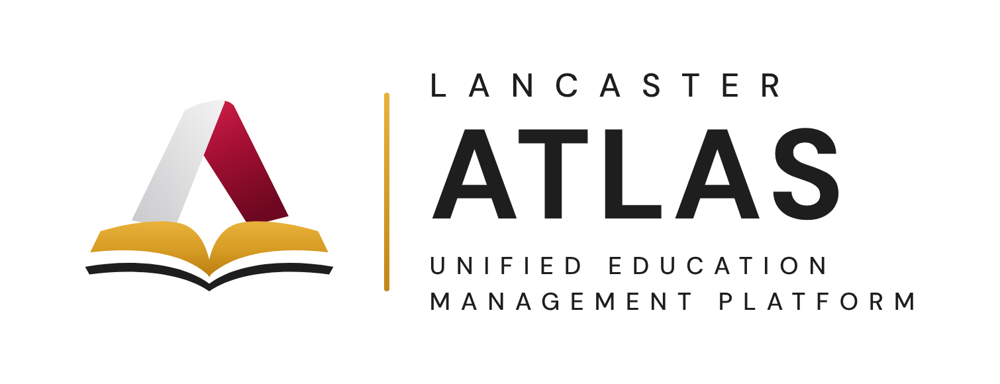
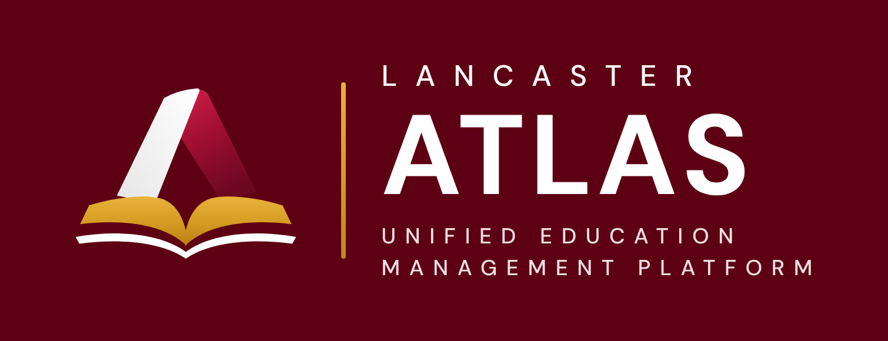
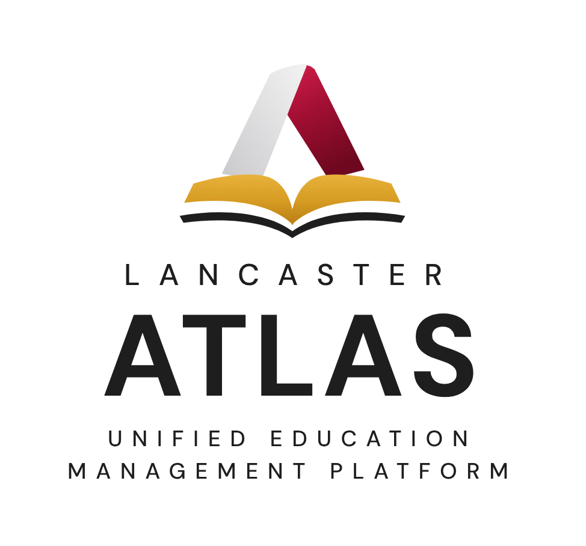
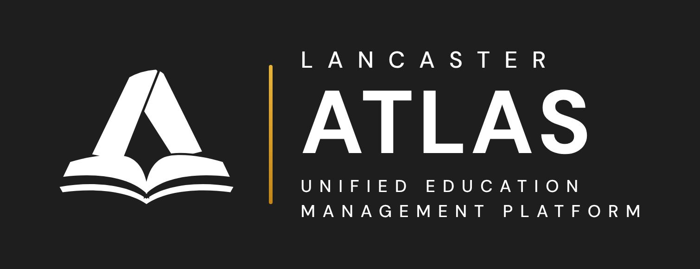

# Lancaster ATLAS brand

**Lancaster ATLAS — Unified Education Management Platform.** ATLAS is the school-side product family of Lancaster Technology and Development Corporation, next to the Lancaster ERP, CORE.

## The mark

A ribbon **A** (one burgundy stroke, one white stroke) standing on a gold **open book**: learning carried by one platform.

| File | Use it on |
| --- | --- |
| `public/img/brand/atlas-mark.svg` | Light backgrounds (top bar in light mode, documents) |
| `public/img/brand/atlas-mark-dark.svg` | Dark or burgundy backgrounds (top bar in dark mode, sign-in panel) |
| `public/img/brand/atlas-mark-white.svg` | One-colour white, e.g. on photos or a solid brand colour |
| `public/img/brand/atlas-mark-black.svg` | One-colour black, e.g. stamps, fax, engraving |
| `public/img/brand/atlas-app-icon.svg` | App icon: the mark on a burgundy rounded tile (browser tab, home-screen icon) |
| `public/img/favicon.png`, `apple-touch-icon.png`, `icon-192.png`, `icon-512.png` | PNG copies of the app icon (48, 180, 192, 512 px) |

The SVGs are drawn by `scripts/brand-mark.py` (`python3 scripts/brand-mark.py public/img/brand`); change the shapes or colours there and run it again rather than editing the SVGs by hand.

## Lockups

| Horizontal | On dark | Stacked | White |
| --- | --- | --- | --- |
|  |  |  |  |

- **Horizontal:** mark, a thin gold rule, then *LANCASTER* (small, widely spaced), **ATLAS** (bold), *UNIFIED EDUCATION MANAGEMENT PLATFORM* (small, spaced).
- **Stacked:** the mark above the words, for square spaces.
- The full lockups are for documents, slides, signage and the website. The apps use the quieter wordmark below.
- Keep clear space around the lockup of at least the height of the letter A in ATLAS. Do not stretch, recolour, outline or add effects to the mark.

## In the apps: quiet, as in CORE

The apps follow the Lancaster ERP, CORE: the brand is present but never repeated.

- **One wordmark per screen.** The top bar shows the mark, **ATLAS** (bold, widely spaced) and, in small grey type, the open product (*Learn*, *People*) or, on the home page, the byline *Education platform by Lancaster*. On phones only **ATLAS** shows. `atlasWord()` in `public/js/shell.js` draws it.
- **Sign-in panel:** the mark with **ATLAS** and the byline at the top, a short kicker (*Unified education management*, *Learn · Admin panel*), the headline, and what the system covers. The mark sits large and faint (7%) in the corner. On phones the panel is hidden and the mark, **ATLAS** and the byline sit above the form.
- **Product names stand alone inside ATLAS:** cards, lists and messages say **Learn**, **People**, **Academic**, never "ATLAS Learn" again and again. The full name (**ATLAS Learn**) is for browser tab titles, documents and anything read outside the app.
- The home page names ATLAS once, in the welcome line. The sidebar footer reads *ATLAS · Education platform by Lancaster*.

## Colours

| Name | Hex | Use |
| --- | --- | --- |
| ATLAS Burgundy | `#5D0013` | Primary: buttons, links, top accents, sign-in panel |
| ATLAS Gold | `#C28618` | Accent: the book, the rule in the lockup, highlights and chips |
| Charcoal | `#1E1E1E` | Text |
| Light gray | `#F5F5F5` | Page background |

The palette lives in `shared/brand.js`; the CSS tokens (`--brand`, `--accent`, `--text`, `--bg`) are in `public/css/styles.css`. "ATLAS Burgundy" is the default colour preset; a school can pick another preset or its own colour under **Admin panel → Settings & branding** and the whole interface follows it. The mark keeps its own colours.

## Type

**DM Sans** (bundled in `public/fonts/`): Bold for *ATLAS* and headings, Medium for labels, Regular for text. Outside the apps, product names are written **ATLAS Learn**; inside them, just **Learn**. Never "Atlas" or "A.T.L.A.S.".

## Product names

| Product | Short name | Old name | Address |
| --- | --- | --- | --- |
| ATLAS home | | University Portal | `/` |
| ATLAS Learn | LMS | LTDC LMS | `/lms/`, admin panel `/admin` |
| ATLAS People | HRIS | HRIS | `/hris/` |
| ATLAS Academic | UIS | UIS | coming soon |
| ATLAS Finance | FMIS | FMIS | coming soon |
| ATLAS Facilities | | (new) | coming soon |

## The school's own logo

A school can upload its logo or seal (**Settings & branding**). It shows small at the foot of the sign-in panel and at the top of payslips, where the school is the employer. The top bar, browser tab and app icon always show the ATLAS mark.

## Unchanged on purpose

As with the CORE rename, only names people see changed. Web addresses (`/lms/`, `/hris/`), the `lms/` folder, cookie names, the systems' ids in saved settings (`uis`, `lms`, `hris`, `fmis`) and the server's service and folder names (`ltdc-lms`) stay the same, so bookmarks, saved settings and running servers keep working.
